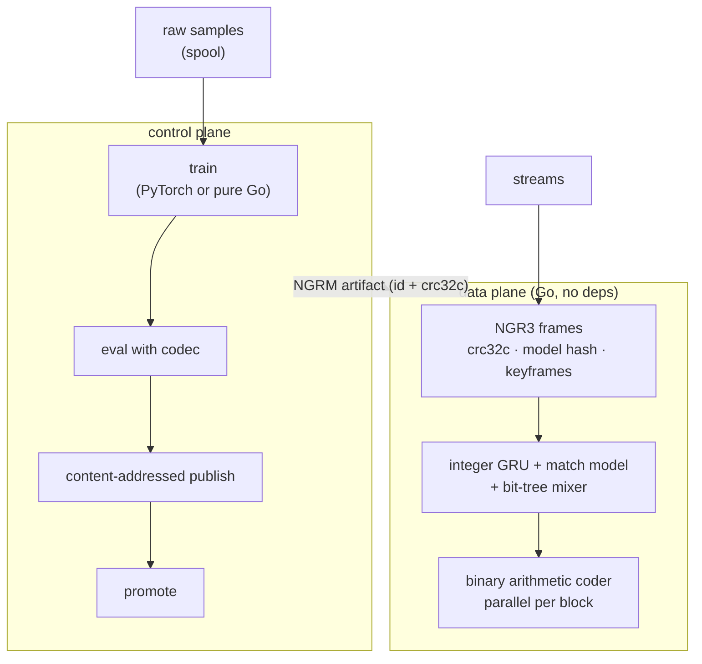

# nzip — deterministic neural compression for telemetry

A two-plane compressor: a Python/PyTorch trainer that fits a byte-level GRU to one
telemetry schema, and a zero-dependency Go codec that runs it across CPU cores.

Generation 3 is a **deterministic, integer-only** codec. It is deliberately
built for a hostile operational reality: archives must decode years later, on a
different CPU architecture, from a different model version, after a retrain.



## Quickstart

```bash
go build -o nzip ./cmd/nzip

# Train on a corpus of the exact bytes you will compress
./nzip train -data otel.ndjson -out m1.bin -model-id 1 -hidden 32 -epochs 6

# Benchmark against gzip -9
./nzip bench -model m1.bin -in holdout.ndjson -block-size 262144

# Which predictor is doing the work?
./nzip ablate -model m1.bin -in holdout.ndjson

# Compress / decompress
./nzip compress   -model m1.bin -in spans.ndjson -out spans.nzip -block-size 262144
./nzip decompress -models . -in spans.nzip -out spans.out
./nzip verify -models . -in spans.nzip
./nzip inspect -in spans.nzip
```

## Three ways to move bytes

| Mode | Use it for | Shape |
| :--- | :--- | :--- |
| `blocks` (default) | large streams, archives | independent blocks, parallel, random access |
| `session` | many small batches from one pusher | persistent model state, serial, resumable keyframes (written only when they cost < 10 % of the data between them) |
| dictionary | short batches, cold start | `WithDictionary` primes both sides (zstd-style) |

In a 64 × 2 KB-batch test, session mode produced **7.2 KB vs 18.2 KB** for
independent blocks. A 8 KiB dictionary cut a 50 KB stream from 14.2 % to 4.0 %.

Library entry points, for a transport you write yourself:

```go
// streaming compressor: Write as batches arrive, Flush per batch
w, _ := stream.NewWriter(dst, registry, "otel-traces",
    stream.WithMode(stream.ModeSession), stream.WithDictionary(dict))
w.Write(batch); w.Flush()

// streaming decompressor: an ordinary io.Reader
r, _ := stream.NewReader(src, registry)
io.Copy(dest, r)
```

## Measured behaviour

Intel i9-13900KF, 32 threads, synthetic OTel/JSON (40 000 spans, 7.4 MB holdout,
random hex IDs — i.e. about 25 % of the bytes are incompressible):

7.4 MB holdout (20 000 spans, random hex identifiers):

| compressor | bytes | ratio | bits/byte |
| :--- | ---: | ---: | ---: |
| gzip -9 | 791,211 | 0.1065 | 0.85 |
| zstd -19 --long | 667,324 | 0.0898 | 0.72 |
| xz -9e | 670,440 | 0.0902 | 0.72 |
| bzip2 -9 | 642,858 | 0.0865 | 0.69 |
| **nzip, H=32, blocks** | **611,579** | **0.0823** | **0.66** |

nzip is **2.0 % smaller than bzip2 -9**, 6 % smaller than xz/zstd and 20 %
smaller than gzip, at 13.2 MB/s across 32 threads. Per core: **1.18 MB/s**
(H=32), 1.70 MB/s (H=16), 0.63 MB/s (H=64).

On the 1 MB slice used for the ablation table below: nzip 84,850 vs bzip2
87,355, xz 91,212, zstd 90,602, gzip 97,673.

**Read this before believing the ratio.** On an under-trained model (3 epochs)
nzip was *8 % worse* than gzip. Most of the win came from the context modelling,
not from the GRU. The ablation is the honest picture:

```
input 1 000 000 bytes, model H=32
predictors                    bytes    ratio     bpb
gzip -9 (baseline)            97673   0.0977   0.781
full (gru+match+table+run)    84850   0.0848   0.679
gru only                     112409   0.1124   0.899
match only                   158233   0.1582   1.266
table only (order-2)         180284   0.1803   1.442
run only                     538355   0.5384   4.307
gru+table+run                 89628   0.0896   0.717
gru+match+run                 86542   0.0865   0.692
match+table+run               97788   0.0978   0.782
```

About two thirds of the output on this corpus is irreducible identifier entropy
(48 hex characters per span). The remaining gap to the strong compressors was
all in structure, and it closed through context modelling, not model capacity —
see `docs/architecture.md` for what did and did not work.

## Out of domain (measured)

The model is trained per dataset, so it is only as good as the corpus it saw.
Two deliberately hostile tests, both with models trained on in-domain data:

**enwik9, the 1 GB Hutter Prize corpus** (trained on a 32 MB enwik8 prefix;
the text profile adds an order-3 context):

| compressor | bytes | ratio |
| :--- | ---: | ---: |
| Hutter record, fx2-cmix-T (2026) | 100,424,672 | 0.1004 |
| xz -9e | 211,776,220 | 0.2118 |
| zstd -19 --long | 230,825,078 | 0.2308 |
| bzip2 -9 | 253,977,891 | 0.2540 |
| **nzip (H=32)** | **249,465,417** | **0.2495** |
| gzip -9 | 322,591,995 | 0.3226 |

nzip finished in 2 m 41 s at 2.1 GB RSS (6.2 MB/s). It is **1.8 % smaller than
bzip2 -9**, 18 % larger than xz -9e, 29 % smaller than gzip and **2.48× the
current record**. Natural-language text wants orders 4–8 and a
count-aware way to ignore sparse contexts; this codec stops at order 2.

**A folder of 20 generated images** (PNG + BMP of noise, gradients, shapes and
smooth fields; 2.79 MB total, per-file compression):

| compressor | bytes | ratio |
| :--- | ---: | ---: |
| **nzip (auto image profile)** | **1,683,407** | **0.6034** |
| xz -9e | 2,039,208 | 0.7309 |
| bzip2 -9 | 2,065,021 | 0.7402 |
| gzip -9 | 2,374,956 | 0.8513 |
| zstd -19 | 2,391,291 | 0.8571 |

With the image profile enabled automatically, nzip is **17 % better than xz and
18 % better than bzip2** on this folder. A gradient bitmap goes from 137 KB to
**87 bytes** (bzip2: 83,460); a smooth photographic field goes from 196 KB
(passthrough) to **135 KB**, where xz needs 187 KB. Incompressible data never
expands beyond the framing overhead (+0.04 % on pure noise).

## Automatic profiles

One configuration cannot serve every kind of data, so each block is classified
from byte statistics (non-ASCII share, printable share, space and markup
density) and the decision is stored in the frame header:

| profile | chosen when | what changes |
| :--- | :--- | :--- |
| `telemetry` | structured/printable data with markup density | order-2 context, run model, match model |
| `text` | prose: mostly printable, ≥ 8 % spaces, little markup | adds an order-3 context |
| `image` | non-ASCII share > 25 % **and** a row stride that reduces residual entropy | row delta or Paeth predictor, chosen by measured entropy |

The row stride is found from the data, not from a file header (a block in the
middle of a file has none): the candidate lag with the highest byte agreement
wins if it exceeds 15 %. On the test folder it found the true 768-byte row
width of a 256×3 BMP.

Measured effect of the classification: natural-language text −15 % (20 MB
slice), image folders −24 %, telemetry −3 % (from the shared SSE stage). Mixed streams round-trip in
both `blocks` and `session` mode (`TestMixedProfilesRoundTrip`).

The honest summary: with the automatic profiles it now **beats bzip2 -9 on all
four corpora measured** (telemetry, text, the 1 GB Hutter corpus, images), sits
between bzip2 and xz on text, and is well ahead of xz on rasters. It is still
2.5× the Hutter record, which lives in a different compute class.

## Determinism

Encoder and decoder derive probabilities from identical integer state:

* weights are quantised to Q11 at load, activations are Q11, dot products
  accumulate in int32 with a proven bound (`96 × 8192 × 2048 < 2^31`);
* `sigmoid`/`tanh`/`exp` are integer LUTs built with integer arithmetic;
* the coder uses Q16 probabilities and a binary arithmetic coder;
* volume kernels (`PMADDWD` on amd64) and the pure-Go fallback perform the same
  exact integer arithmetic, so they cannot disagree.

`GOARCH=arm64` is compiled in CI, and the `purego` build tag exercises the
scalar path on every run.

## Layout

```text
cmd/nzip/          CLI: compress, decompress, bench, eval, ablate, verify,
                   inspect, train, pipeline, models
codec/             integer GRU, match model, bit-tree mixer, binary coder,
                   SSE2 dot products (dot_amd64.s)
model/             NGRM v2 artifact, quantisation, hash-checked registry
stream/            NGR3 framing, blocks/session modes, dictionary, keyframes,
                   io.Writer/io.Reader adapters
drift/             EWMA bits-per-byte monitor with recovery
store/fs/          content-addressed artifacts + per-dataset active manifest
internal/train/    dependency-free trainer (enables CI and the pipeline)
train.py           PyTorch trainer, same architecture
docs/              wire format, design notes, training guidance
```

## Documentation

* [docs/format.md](docs/format.md) — NGR3 stream and NGRM artifact formats
* [docs/architecture.md](docs/architecture.md) — components, profiles,
  determinism, measured results and the experiments that were rejected
* [docs/training-otel-json.md](docs/training-otel-json.md) — building a corpus
